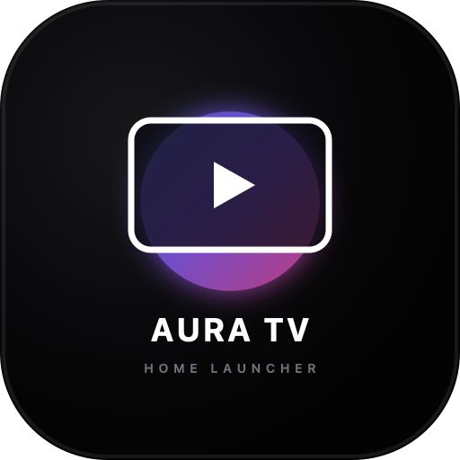

<p align="center">
  
</p>

<h1 align="center">Aura TV</h1>

<p align="center">
  <b>A minimal, ad-free, 60FPS custom launcher and sideloading tool for Hisense TVs running VIDAA OS.</b><br>
  <i>Replace cluttered, sponsored home screens with a clean, cinema-grade interface. No root, no ADB, nothing uninstalled.</i>
</p>

<p align="center">
  
  
  
  
  
</p>

<p align="center">
  <a href="https://cralex11.github.io/aura-tv/"><b>🌐 Live Web Demo</b></a> • 
  <a href="#-quick-start"><b>⚡ Quick Start</b></a> • 
  <a href="#-install-with-ai-coding-agents"><b>🤖 Install with AI</b></a> • 
  <a href="#-how-it-works"><b>🛠 How It Works</b></a>
</p>

---

## 📺 Why Aura TV?

Projects like *CleanYourTV* cleaned up millions of Android TVs over ADB port 5555. But **hundreds of millions of Smart TVs (like Hisense running VIDAA OS)** are built on closed Linux platforms with **port 5555 disabled**—meaning traditional ADB tools cannot run there.

Meanwhile, their stock home screens have become filled with:
- ❌ Giant unskippable banner advertisements and autoplaying trailers.
- ❌ Irremovable sponsored content rows taking up 80% of the screen.
- ❌ Persistent background analytics and viewing telemetry.
- ❌ Sluggish 20–30 FPS navigation caused by unoptimized web renderers.

**Aura TV solves this over the local companion protocol (port 36669).** It permanently registers a clean, high-performance home screen directly into the TV's native application database—delivering a fluid, ad-free living room experience.

---

## 📊 Stock TV vs. Aura TV

| Feature | Stock Smart TV Home | Aura TV |
| :--- | :--- | :--- |
| **Home Screen Ads** | ❌ Full-screen banners & sponsored promo rows | ✅ **Zero ads, zero sponsored content** |
| **Frame Rate** | ⚠️ Sluggish 20–30 FPS (heavy background scripts) | ⚡ **Locked 60 FPS GPU hardware-composited** |
| **Ambient Lighting** | ❌ None or static dark gray | 🌈 **Dynamic ambient glow matching the active app** |
| **Sound Feedback** | ❌ Generic system clicks | 🎵 **Synthesized UI audio engine (Web Audio API)** |
| **Top Shelf Spotlight** | ❌ Promoted movies you have to pay for | 🎬 **Rich synopsis, HDR badges & technical specs** |
| **Custom App URLs** | ❌ Blocked (walled garden app store only) | 🌐 **Launch any web portal or stream on demand** |
| **Modifications** | ❌ Proprietary locked OS | 🔒 **No root, no cable, no developer mode required** |

---

## 🚀 Quick Start

| You have | Recommended Action |
| :--- | :--- |
| **An AI Assistant** *(Claude Code, Gemini CLI, ChatGPT, Cursor, Antigravity)* | Paste the [AI Prompt](#-install-with-ai-coding-agents): the AI connects over Wi-Fi, pairs, and injects the tile automatically. |
| **A Terminal & Python** | Run the one-line injection script in [Doing It by Hand](#-doing-it-by-hand). |
| **No computer** | Open the [Live Web Demo](https://cralex11.github.io/aura-tv/) directly inside your Smart TV browser. |

---

## 🤖 Install with AI Coding Agents

If you use an agentic coding assistant with shell/network access (e.g. **Claude Code**, **Gemini CLI**, **Antigravity CLI**, **Cursor**, or **ChatGPT**), copy and paste this single prompt:

```markdown
I want to install Aura TV on my Hisense Smart TV (running VIDAA OS) and replace the cluttered, ad-filled home screen with a clean, 60FPS minimalist launcher.

My TV's IP address on my local Wi-Fi is: <YOUR_TV_IP_HERE>

Work step by step:
1. Check that Python 3 and the `paho-mqtt` package are available in my environment. If missing, install it (`pip install paho-mqtt`).
2. Verify network connectivity to my TV on port 36669 (the TV's local companion protocol).
3. Clone the Aura TV repository if not already in your working directory:
   git clone https://github.com/cralex11/aura-tv.git
   cd aura-tv
4. Run the injection tool:
   python3 tools/inject.py <YOUR_TV_IP_HERE>
5. When the 4-digit pairing PIN pops up on my TV screen, ask me for it, then submit it to complete mutual TLS authorization.
6. Verify that the Aura TV launcher tile is permanently registered in the TV's application database and send the signal to launch it on my screen.
7. Tell me once it is launched and guide me through the quick remote control steps to pin it to position #1 on my home row and set auto-boot on power-on.
```

*(You can also find this prompt in [`PROMPT.md`](PROMPT.md)).*

---

## 💻 Doing It by Hand

If you prefer to run the installation yourself from a terminal on your computer:

```bash
# 1. Clone the repository
git clone https://github.com/cralex11/aura-tv.git
cd aura-tv

# 2. Install the lightweight MQTT client
pip install paho-mqtt

# 3. Run the automated TV injector
python3 tools/inject.py <YOUR_TV_IP>
```

> **Where to find your TV IP**:  
> On your TV remote, go to **Settings (⚙️)** $\rightarrow$ **Network** $\rightarrow$ **Network Configuration** (or Network Status). You will see an IPv4 address like `192.168.1.50`.

### Follow the On-Screen Terminal:
1. The script connects to the TV on port 36669 over mutual TLS.
2. A **4-digit PIN** will pop up on your TV screen.
3. Type the 4 digits into your terminal prompt and press **Enter**.
4. The script exchanges the PIN for a permanent session token and writes Aura TV directly into the TV's launcher flash database.
5. The TV will automatically open Aura TV fullscreen!

---

## 📌 Pinning Aura TV as #1 on Your Home Screen

After injection, configure your TV to make Aura TV your primary living room interface:

```
[TV Remote Home] ➔ [Highlight Aura TV] ➔ [Hold OK / Press Options ☰] ➔ [Move to #1 Spot on Far Left]
```

### ⚡ Auto-Boot Directly into Aura TV on Power-On:
1. On your TV remote, open **Settings (⚙️)**.
2. Navigate to **System** $\rightarrow$ **Advanced** $\rightarrow$ **Power On Mode**.
3. Select **"Remember Last App / Input"** (or *"Restore Last State"*).
4. Now, every time you turn your TV on, it bypasses the stock ad-filled dashboard and boots directly into Aura TV!

---

## 🛠 How It Works

Smart TVs running VIDAA OS do not allow sideloading standard Android APKs. However, they expose an internal **MQTT remote companion broker on port 36669** protected by client-certificate mutual TLS (`mTLS`).

```
┌─────────────────────────┐          Port 36669 (mTLS)          ┌─────────────────────────┐
│   Computer / AI Agent   │ ─────────────────────────────────>  │     Smart TV (VIDAA)    │
│  (tools/inject.py)      │ <─────────────────────────────────  │   MQTT Companion Broker │
└─────────────────────────┘      One-time 4-digit PIN Auth      └─────────────────────────┘
             │                                                               │
             │  app_install payload (actions/uievent)                        │
             └───────────────────────────────────────────────────────────────┘
                                             │
                                             ▼
                                ┌─────────────────────────┐
                                │   TV Flash Database     │
                                │   Registers Aura TV as  │
                                │   Permanent Native Tile │
                                └─────────────────────────┘
```

| Step | Protocol Action | What Happens |
| :--- | :--- | :--- |
| **1. Handshake** | TLS with client certs | Establishes a secure companion channel on port 36669. |
| **2. Pairing** | `actions/vidaa_app_connect` | Triggers the TV's native on-screen 4-digit PIN dialog. |
| **3. Authorization** | `actions/authenticationcode` | Validates the PIN and returns a persistent auth token. |
| **4. Injection** | `actions/uievent` | Writes the app record (`auratv`, title, icon, and URL) into the TV's launcher flash storage. |
| **5. Launch** | `actions/launchapp` | Launches Aura TV in native fullscreen WebKit kiosk mode. |

**Safety Guarantee**: Nothing is flashed, no system binaries are modified, and your TV's warranty remains intact. If you ever want to remove Aura TV, simply highlight the tile on your TV and press *Delete*.

---

## 🎮 Included Applications

Aura TV comes pre-configured with popular smart TV streaming sources:

| Tile | Purpose | Features |
| :--- | :--- | :--- |
| **Stremio** | Movies & TV Series | Full TV build with 4K HDR playback, community add-ons, and Debrid integration. |
| **Lampa** | Online Video Scraper | Rich online streaming catalog with multi-voice audio options. |
| **Piped TV** | Ad-Free YouTube | Streams YouTube videos with built-in SponsorBlock and zero account tracking. |
| **Media Station X** | IPTV & Scraper Hub | Extensible portal launcher for ForkPlayer, VoKino, and custom `.m3u` channel playlists. |
| **Netflix** | Official Portal | High-definition on-demand streaming. |
| **Plex** | Personal Media | Direct play from your home PC or NAS media library. |
| **Web Browser** | Web Portals | Fullscreen internet browser for custom stream links. |

---

## 🏎️ Technical Architecture: Why It Runs at 60FPS

Most web-based TV dashboards suffer from noticeable frame drops because desktop web designs do not translate well to low-power TV chipsets. Aura TV is built around strict TV performance principles:

1. **Zero CSS Blur Filters**: Standard `backdrop-filter: blur()` forces Smart TV WebKit engines into CPU software rendering mode, dropping frame rates to 15–20 FPS. Aura TV uses pre-rendered dual-layer radial gradients that crossfade exclusively via **GPU `opacity`**, maintaining a locked 60 FPS.
2. **Fixed 1080p Viewport**: Built on `<meta name="viewport" content="width=1920, height=1080">` with vector SVGs to prevent the TV from downsampling to 720p or applying blurry bilinear scaling.
3. **Hardware Layer Promotion**: All moving elements utilize `transform: translate3d(...)` and `will-change: transform` to run entirely on the GPU compositor thread.
4. **Zero Idle Overhead**: When you aren't pressing buttons on the remote, all animation loops halt, keeping the TV's CPU/GPU completely idle.

---

## ⌨️ Remote Control & Keyboard Mapping

| Key | Remote Button | Action |
| :--- | :--- | :--- |
| **◀ ▶** | D-Pad Left / Right | Scroll through the apps carousel with smooth centering. |
| **▲ ▼** | D-Pad Up / Down | Switch between Header Actions, Top Shelf, Apps, and Hardware Tools. |
| **Enter / Select** | OK | Launch the selected app in fullscreen. |
| **Escape / Back** | Return / Back | Dismiss open modal dialogs / Snap focus back to main apps rail. |
| **1 – 7** | Number keys 1–7 | Fast-launch app slots 1 through 7 instantly. |

---

## 🌐 Customizing Your Own URL / Apps

Aura TV is fully customizable. You can host your own fork on GitHub Pages or a local server and inject it with custom titles and endpoints:

```bash
python3 tools/inject.py <YOUR_TV_IP> --title "My Home Theater" --url "https://my-domain.com"
```

---

## 📄 License

Distributed under the **MIT License**. Free and open-source for the entire smart TV community.
